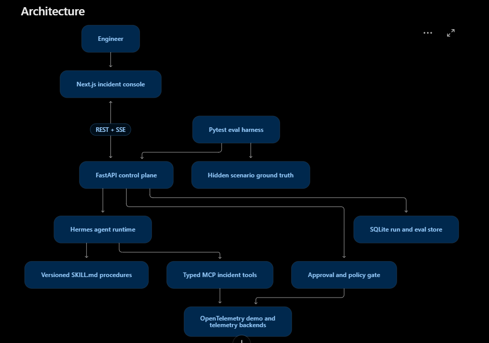
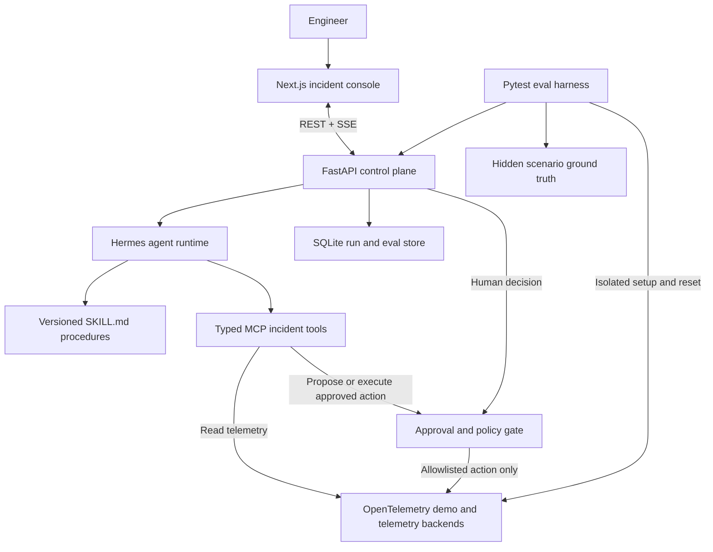

# Planned architecture

Status: proposed target reconstructed from the supplied screenshot and reference
plan. Only the deterministic Python starter is implemented today.

The editable diagram makes two intended boundaries explicit: mutation passes
through the policy gate, and scenario controls/answers belong to the eval harness.
The screenshot is preserved as supplied; these labeled edges clarify the planned
enforcement responsibilities rather than document an existing implementation.

## Component ownership

| Component | Responsibility |
| --- | --- |
| Next.js UI | Incident timeline, dependencies, evidence inspection, approval/rejection, eval comparison, skill versions |
| FastAPI | Incident/run lifecycle, validated assessments, durable event stream, human decisions, persistence |
| Hermes adapter/runtime | Model/tool loop, skill selection, provider integration; isolated behind an application interface |
| MCP server | Typed, bounded telemetry queries and controlled action entry points; auditable results |
| Evidence registry | Resolve evidence IDs to retrieved observations, source query/window, timestamps, and run |
| Policy/action gate | Validate incident/proposal-bound human approval and allowlisted parameters; prevent replay and duplicate execution |
| OpenTelemetry demo/backends | Real system under investigation, synthetic traffic, fault mechanisms, logs/metrics/traces |
| Scenario/eval harness | Privileged setup/reset, hidden answer key, deterministic scoring, comparable trials |
| SQLite | Persist runs, evidence, events, proposals, approvals, execution outcomes, versions, usage, scores |

The evidence registry can live within the API/store implementation; this is a
logical responsibility, not a new required service. The model-facing tool server
must not expose privileged harness endpoints or unrestricted runtime tools.

## Investigation lifecycle

1. An alert and bounded incident window create a run.
2. Hermes loads general procedures and chooses typed read tools.
3. Each observation receives a run-scoped evidence reference and provenance.
4. The application validates an assessment with supported claims and uncertainty.
5. A predefined remediation proposal presents its exact effect to the engineer.
6. A human decision authorizes or rejects that immutable proposal.
7. The action gate validates the decision and consumes one execution authorization.
8. Fresh telemetry determines recovered, not recovered, or unverified.
9. A report and eval results remain inspectable after reload.

## Data and trust boundaries

- Model inputs contain observations, not scenario IDs, fault names, reset controls,
  answer keys, or hidden expected evidence. Change-history observations need review
  so they do not become an indirect answer-key channel.
- Telemetry and skill reference material cannot grant permissions. The executor
  validates authority independently of the model's output.
- FastAPI owns the browser-facing stream and durable event history. Hermes events
  are mapped into it; the UI does not need runtime credentials.
- A local change journal may be needed because a deployment-history feed has not
  been established. Its origin must be disclosed.
- Stored tool transcripts support audit and recorded playback; they do not promise
  bit-for-bit reproducibility of future LLM runs.

See [the daily plan](../PROJECT_PLAN.md) for implementation order and
[the status ledger](project-status.md) for unresolved decisions.
